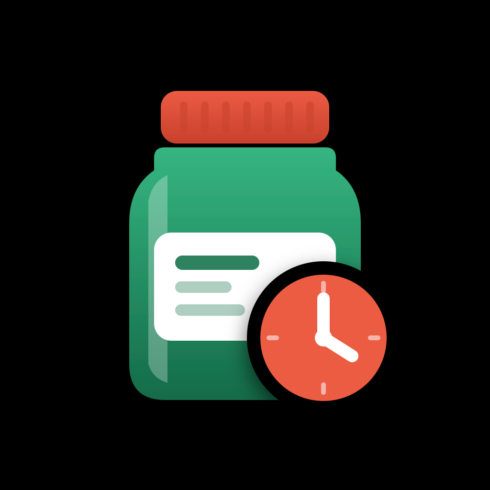

# Vencito



**Vencito** es una app para iPhone, iPad y Android que lee la fecha de vencimiento de una foto del envase y te avisa antes de que se venza. Todo se procesa en el dispositivo: sin cuentas, sin servidores propios, sin publicidad. También hay una versión web (PWA) en https://vencito.app/app/.

*Vencito is an iPhone, iPad and Android app that reads the expiration date from a photo of the package and reminds you before it expires. Everything runs on-device: no accounts, no servers of its own, no ads. There is also a web version (PWA) at https://vencito.app/app/.*

- 🌐 Sitio · Website: **https://vencito.app/**
- 🔒 [Política de privacidad · Privacy policy](https://vencito.app/privacy.html)
- 🛟 [Soporte · Support](https://vencito.app/support.html) · [Issues](https://github.com/diegokelya/vencito/issues)

## Qué hay en este repo · What's in this repo

Este es el repositorio **público** de Vencito: el sitio del producto (GitHub Pages), la política de privacidad, la página de soporte y el canal de reportes. El código de la app es privado.

*This is Vencito's **public** repository: the product website (GitHub Pages), privacy policy, support page and issue tracker. The app's source code is private.*

```
index.html        Sitio en español · Spanish landing page
en/ pt/ fr/       Sitio en inglés, portugués (Brasil) y francés · English, Portuguese (Brazil), French
it/ de/           Sitio en italiano y alemán · Italian, German
privacy.html      Política de privacidad en los 6 idiomas — URL para App Store Connect y Play Console
support.html      Soporte en los 6 idiomas — URL para App Store Connect y Play Console
404.html          Página de error
app/              Vencito en el navegador (PWA): sin cuentas, funciona sin conexión
assets/           Estilos, script del demo, tipografías, ícono, capturas y videos
tests/            Pruebas de la PWA y del demo (node --test tests/)
robots.txt        Para buscadores, con el enlace al sitemap
sitemap.xml       Páginas del sitio con sus versiones por idioma
```

## URLs para App Store Connect

| Campo | URL |
|---|---|
| Support URL | `https://vencito.app/support.html` |
| Marketing URL | `https://vencito.app/` |
| Privacy Policy URL | `https://vencito.app/privacy.html` |

## Publicar cambios · Publishing

GitHub Pages sirve la rama `main` desde la raíz (*Settings → Pages → Deploy from a branch → main / (root)*). Cada push a `main` actualiza el sitio en uno o dos minutos. No hay build: es HTML, CSS y JS plano.

Las tipografías (Familjen Grotesk, Onest y Doto, licencia OFL) están en `assets/fonts/`: el sitio no hace pedidos a terceros. La PWA trae también Tesseract.js (OCR), ZXing y PDF.js (Apache-2.0, ver `app/vendor/PDFJS-LICENSE.txt`), todo en `app/vendor/`.

Para ver el sitio localmente: `python3 -m http.server` y abrir http://localhost:8000.

Pruebas: `npm test` (sin dependencias; corre `node --test tests/`). También corren en GitHub Actions en cada PR que toca `app/`, `assets/site.js` o `tests/`.

## Licencia · License

Contenido y código del sitio bajo licencia MIT. "Vencito" y el ícono son marcas del autor.
